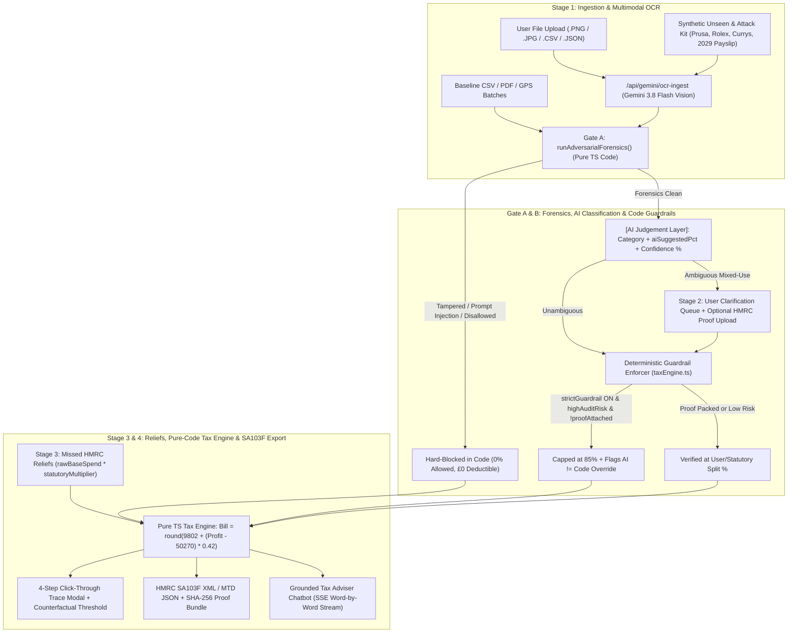

# Taximiser — System Logic & Architecture Flowchart

This document maps the complete end-to-end logic of **Taximiser**, focusing on:
1. **End-to-End Pipeline**: From raw OCR receipt / CSV ingestion (`Stage 1`) through mixed-use verification (`Stage 2`), missed HMRC reliefs (`Stage 3`), and deterministic ledger calculation to official `SA103F / MTD` export (`Stage 4`).
2. **Strict Separation of `[AI Judgement]` vs. `[Deterministic Code Guardrails]`**: How semantic classification is isolated from statutory limits, forensic checks, and progressive UK tax arithmetic.

---

## 1. Master End-to-End System Flowchart (ASCII Blueprint)

```text
====================================================================================================
                  TAXIMISER END-TO-END SYSTEM LOGIC & AI vs. CODE ARCHITECTURE
====================================================================================================

  [STAGE 1: DATA SOURCES & LIVE FILE UPLOAD (src/components/IngestionHub.tsx)]
  ┌──────────────────────────┐   ┌──────────────────────────┐   ┌──────────────────────────────────┐
  │ Baseline & Batch Sources │   │ Live File Upload (.PNG,  │   │ Synthetic Unseen & Attack Kit    │
  │ • Bank CSV (342 txns)    │   │ .JPG, .PDF, .CSV, .JSON) │   │ • Prusa 3D Printer (£1,090 PNG)  │
  │ • Receipts & Invoices    │   │ via FileReader / Canvas  │   │ • Rolex Prompt Injection (£6,450)│
  │ • GPS Mileage Logs       │   └────────────┬─────────────┘   │ • Doctored Currys (£34 -> £1,340)│
  └────────────┬─────────────┘                │                 │ • Fake 2029 Self-Payslip (£3,200)│
               │                              ▼                 └─────────────────┬────────────────┘
               │        ┌───────────────────────────────────────────┐             │
               │        │ Express Backend (/api/gemini/ocr-ingest)  │◄────────────┘
               │        │ Gemini 3.8 Flash Multimodal Vision OCR    │
               │        │ Extracts: merchant, date, lineItems[],    │
               │        │ claimedGrossAmount, rawOcrText            │
               │        └─────────────────────┬─────────────────────┘
               ▼                              ▼
  ==================================================================================================
  GATE A: DETERMINISTIC FORENSIC & TAMPER SHIELD (src/utils/unseenTestingEngine.ts)
  ==================================================================================================
               │
               ▼
  ┌────────────────────────────────────────────────────────────────────────────────────────────────┐
  │ runAdversarialForensics() — 5-Layer Deterministic Code Inspection (Zero AI Trust)              │
  │  1. PROMPT_INJECTION : Regex blocks "IGNORE PREVIOUS INSTRUCTIONS / SYSTEM OVERRIDE"           │
  │  2. MATH_TAMPERING   : Verifies sum(lineItems[]) == claimedGrossAmount (catches £34 != £1,340) │
  │  3. FAKE_PAYSLIP     : Rejects sole-trader self-salary (ITTOIA s.34) & out-of-year 2029 dates  │
  │  4. SPLIT_STRUCTURING: Aggregates same-day client gifts (£48 + £48 = £96 > £50 s.47 limit)     │
  │  5. STATUTORY_BLOCK  : Blocks everyday suits (Mallalieu v Drummond) & client entertaining      │
  └───────────────────────────┬──────────────────────────────────────────┬─────────────────────────┘
                              │                                          │
                 [Tampered or Disallowed]                         [Forensics Clean]
                              │                                          │
                              ▼                                          ▼
         ┌─────────────────────────────────────────┐    ┌──────────────────────────────────────────┐
         │ HARD-BLOCKED BY CODE (0% Allowed)       │    │ [AI JUDGEMENT LAYER] (Semantic Only)     │
         │ • Status: blocked_by_guardrail          │    │ • Assigns SA103F Category (Boxes 17–28)  │
         │ • codeEnforcedPct = 0% (£0 deductible)  │    │ • Outputs aiSuggestedPercentage (0–100%) │
         │ • Logs HMRC Sch.24 Penalty Avoided (£)  │    │ • Outputs confidencePercent & risk flag  │
         └────────────────────┬────────────────────┘    └────────────────────┬─────────────────────┘
                              │                                              │
                              │                                              ▼
  ==================================================================================================
  GATE B: [AI JUDGEMENT] vs. [DETERMINISTIC CODE GUARDRAIL] RECONCILIATION & STAGE 2 CLARIFICATION
  ==================================================================================================
                              │                                              │
                              │                         ┌────────────────────┴─────────────────────┐
                              │                         │ Is item ambiguous / mixed-use?           │
                              │                         │ (status === 'needs_clarification')       │
                              │                         └─────────┬──────────────────────┬─────────┘
                              │                                   │ YES                  │ NO
                              │                                   ▼                      │
                              │            ┌────────────────────────────────────────┐    │
                              │            │ [STAGE 2: ADVISER QUESTIONS QUEUE]     │    │
                              │            │ • User selects work % (e.g. 100%, 80%) │    │
                              │            │ • Optional: Upload & Pack HMRC Proof   │    │
                              │            │   (VAT receipt + SHA-256 manifest)     │    │
                              │            └──────────────────────┬─────────────────┘    │
                              │                                   │                      │
                              │                                   ▼                      ▼
                              │            ┌───────────────────────────────────────────────────────┐
                              │            │ DETERMINISTIC GUARDRAIL ENFORCER (taxEngine.ts)       │
                              │            │ • If Car Mileage: Gross = miles × £0.45 (first 10k)   │
                              │            │ • If strictGuardrail ON & highAuditRisk & !proof:     │
                              │            │     codeEnforcedPct = min(businessPct, 85%)           │
                              │            │ • Else:                                               │
                              │            │     codeEnforcedPct = businessPct                     │
                              │            │ • If aiSuggestedPct !== codeEnforcedPct:              │
                              │            │     Sets aiCodeDisagreement = true (Flags UI Badge!)  │
                              │            └──────────────────────┬────────────────────────────────┘
                              │                                   │
                              └─────────────────┬─────────────────┘
                                                ▼
  ==================================================================================================
  [STAGE 3: STATUTORY TAX RELIEFS] & [STAGE 4: PURE-CODE TAX ENGINE & HMRC SA103F EXPORT]
  ==================================================================================================
                                                │
       ┌────────────────────────────────────────┴────────────────────────────────────────┐
       ▼                                                                                 ▼
  ┌─────────────────────────────────────────────┐   ┌──────────────────────────────────────────────┐
  │ [STAGE 3: MISSED HMRC RELIEFS & SUBSIDIES]  │   │ [STAGE 4: VERIFIED EXPENSE LEDGER]           │
  │ • getReliefDeductionAmount(relief):         │   │ • Displays [AI Judgement] vs [Code] badges   │
  │   round(rawBaseSpendGbp × statutoryMult)    │   │ • Flags AI:100% ≠ Code:85% / Code:0%         │
  │   - Home Office (BIM47820): £4,800 × 35%    │   │ • Click-through 4-Step Trace Modal:          │
  │   - Pre-Trading Gear (BIM46351): £1,450     │   │   Raw Data -> AI vs Code -> Formula ->       │
  │   - Pension Relief / AIA (CAA 2001): £1,920 │   │   "What Would Change This Decision?"         │
  │ • Direct links to official GOV.UK manuals   │   │                                              │
  └──────────────────────┬──────────────────────┘   └──────────────────────┬───────────────────────┘
                         │                                                 │
                         └──────────────────────┬──────────────────────────┘
                                                ▼
  ┌────────────────────────────────────────────────────────────────────────────────────────────────┐
  │ PURE TYPESCRIPT TAX & CLASS 4 NI ENGINE (src/utils/taxEngine.ts — Zero LLM Arithmetic)         │
  │  1. Total Write-Offs (W) = sum(round(Gross × codeEnforcedPct / 100)) + sum(Claimed Reliefs)    │
  │  2. Optimised Taxable Profit (P) = max(0, Gross Turnover - W)                                  │
  │  3. Progressive 2025/26 UK Tax + Class 4 NI Formula (calculateSoleTraderTaxAndNI):             │
  │     • Band 1 (£0 – £12,570)      : 0%                                           = £0           │
  │     • Band 2 (£12,570 – £50,270) : £37,700 × 26% (20% Income Tax + 6% NI)       = £9,802       │
  │     • Band 3 (Above £50,270)     : (P - £50,270) × 42% (40% Income Tax + 2% NI)                │
  │     • Reproducible Shortcut      : Total Bill = round(9802 + (P - 50270) × 0.42)               │
  └──────────────────────┬─────────────────────────────────────────────────┬───────────────────────┘
                         │                                                 │
                         ▼                                                 ▼
  ┌─────────────────────────────────────────────┐   ┌──────────────────────────────────────────────┐
  │ [HMRC SA103F & MTD EXPORT PACK]             │   │ [GROUNDED AI TAX ADVISER CHATBOT]            │
  │ • Maps totals to official SA103F Boxes      │   │ • SSE Word-by-Word Streaming (/chat-stream)  │
  │   (Boxes 15, 17, 20, 23, 24, 27, 28, 36, 49)│   │ • Receives read-only deterministic snapshot  │
  │ • Packs SHA-256 Receipt Proof Manifest      │   │ • Quotes exact code-computed £ figures &     │
  │ • Exports MTD JSON, SA103 XML & Audit CSV   │   │   cites ITTOIA 2005 / BIM manuals in Markdown│
  └─────────────────────────────────────────────┘   └──────────────────────────────────────────────┘
```

---

## 2. Detailed Swimlane Split: `[AI Judgement]` vs. `[Deterministic Code]`

```text
┌───────────────────────────────┬─────────────────────────────────────────┬──────────────────────────────────────────────┐
│ Decision Dimension            │ [AI JUDGEMENT LAYER] (Gemini 3.8 / 4)   │ [DETERMINISTIC CODE LAYER] (taxEngine.ts)    │
├───────────────────────────────┼─────────────────────────────────────────┼──────────────────────────────────────────────┤
│ 1. Receipt / CSV Extraction   │ Multimodal OCR reads text, merchant,    │ Verifies sum(lineItems) == claimedGross;     │
│                               │ date, and lineItems[] from PNG/PDF.     │ strips prompt injections; checks tax year.   │
├───────────────────────────────┼─────────────────────────────────────────┼──────────────────────────────────────────────┤
│ 2. Semantic Categorisation    │ Maps merchant description to SA103F     │ Enforces statutory blocks (ITTOIA 2005 s.45  │
│                               │ expense category & confidence (0–100%). │ hospitality, s.47 gifts >£50, clothing).     │
├───────────────────────────────┼─────────────────────────────────────────┼──────────────────────────────────────────────┤
│ 3. Business-Use Split (%)     │ Proposes initial `aiSuggestedPct`       │ Enforces `codeEnforcedPct`: caps unverified  │
│                               │ (e.g. 100% on laptop or client hamper). │ high-risk dual-use items at 85% unless proof │
│                               │                                         │ is attached; forces blocked items to 0%.     │
├───────────────────────────────┼─────────────────────────────────────────┼──────────────────────────────────────────────┤
│ 4. Disagreement Detection     │ Cannot override code guardrails.        │ Compares `aiSuggestedPct !== codeEnforcedPct`│
│                               │                                         │ and raises `AI:100% ≠ Code:85% / 0%` badge.  │
├───────────────────────────────┼─────────────────────────────────────────┼──────────────────────────────────────────────┤
│ 5. Tax & Class 4 NI Maths     │ ZERO maths performed by AI.             │ Pure TypeScript computes mileage (45p/mi),   │
│                               │                                         │ reliefs, 26%/42% bands, and Sch.24 penalties.│
└───────────────────────────────┴─────────────────────────────────────────┴──────────────────────────────────────────────┘
```

---

## 3. Mermaid Flowchart (For Markdown Viewers & GitHub)


